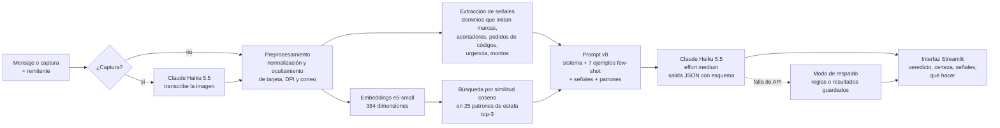

# Ojo Chapín: ¿es estafa?

Detector de estafas en mensajes de WhatsApp y SMS pensado para Guatemala. La persona pega el mensaje sospechoso (o sube una captura de pantalla) y Ojo Chapín le dice si es una estafa, por qué y qué hacer, en lenguaje sencillo.

Proyecto 3 de CC3092 Deep Learning y Sistemas Inteligentes, UVG.

- Fernando Andree Hernández Martínez - 23645
- Fernando José Rueda Rodas - 23748

## Problema y usuario

Las estafas digitales crecen rápido en Guatemala: los ciberdelitos registrados por el MP pasaron de 1,292 en 2019 a 14,871 en 2025 (ver [docs/fuentes.md](docs/fuentes.md)). El usuario objetivo es cualquier persona que recibe un mensaje dudoso, en especial adultos mayores y sus familias, que hoy lo resuelven preguntándole a un familiar o simplemente adivinando. Ojo Chapín da una respuesta en unos 3 segundos, explica las señales concretas y recomienda acciones, incluidos los canales oficiales de denuncia.

## Cómo funciona



- **LLM:** `claude-haiku-5-5`, el modelo más económico de Anthropic ($0.10 por millón de tokens de entrada y $0.50 por millón de salida). Cada análisis usa unos 3,400 tokens de entrada y 470 de salida, cuesta unos $0.0006 y tarda unos 3.3 s.
- **Salida estructurada:** el modelo responde con un JSON validado contra un esquema (`veredicto`, `certeza`, `tipo`, `senales`, `explicacion`, `que_hacer`), así que no hay respuestas con formato roto.
- **RAG:** la base de conocimiento son 25 patrones de estafa documentados con fuentes guatemaltecas. Se indexan con `intfloat/multilingual-e5-small` y se recuperan los 3 más parecidos por similitud coseno.
- **Seguridad:** el mensaje va entre etiquetas y el prompt instruye ignorar instrucciones dentro de él (los dos casos de prompt injection del conjunto de prueba se detectan como estafa). La llave de API se lee de `.env`, que está fuera del repositorio.

## Resultados

Conjunto de desarrollo: 60 mensajes construidos a partir de las modalidades documentadas (30 estafas y 30 legítimos difíciles, como códigos de bancos, alertas reales y familiares pidiendo dinero desde un contacto guardado). Se considera alerta cuando el veredicto es "estafa" o "sospechoso".

| Iteración | Cambio | Estafas detectadas | Falsas alarmas | Latencia | Costo/msj |
|---|---|---|---|---|---|
| B1 | Reglas sobre las señales (sin LLM) | 23 de 30 | 0% | ~0 s | $0 |
| B2 | TF-IDF + regresión logística (sin LLM) | 27 de 30 | 13.3% | ~0 s | $0 |
| L1 | Haiku, prompt simple (SI o NO) | 30 de 30 | 20.0% | 1.0 s | $0.00003 |
| L2 | + prompt de sistema y salida JSON | 30 de 30 | 20.0% | 3.1 s | $0.0004 |
| L3 | + señales del preprocesamiento | 30 de 30 | 20.0% | 3.4 s | $0.0004 |
| L4 | + RAG con 3 patrones | 30 de 30 | 16.7% | 2.7 s | $0.0004 |
| L5 | + 5 ejemplos few-shot | 30 de 30 | 16.7% | 2.5 s | $0.0005 |
| L6 | + criterio estricto para "sospechoso" (v6) | 30 de 30 | 6.7% | 2.6 s | $0.0005 |
| L7 | L6 sin razonamiento | 30 de 30 | 13.3% | 2.8 s | $0.0005 |
| L8 | L6 con effort medium | 30 de 30 | 0% | 2.9 s | $0.0005 |
| L9 | L8 con 25 patrones y fuentes reales | 30 de 30 | 0% | 3.1 s | $0.0005 |
| L10 | L9 con prompt v7 | 30 de 30 | 0% | 3.3 s | $0.0006 |
| **L11** | **L10 con prompt v8 y señales de publicidad de marcas (versión final)** | **30 de 30** | **0%** | **3.2 s** | **$0.0007** |

L6, L8 y L10 se corrieron 3 veces para medir la variación (`resultados/varianza.csv`): L8 y L10 dieron los mismos resultados en las tres corridas.

**Mensajes reales.** Como el prompt se ajustó mirando errores del conjunto de prueba, también evaluamos en 12 mensajes de estafa reales citados por medios guatemaltecos (`data/reales.jsonl`), que no se usaron para diseñar el sistema. La versión L9 detectó 10 de 12; las dos fallas eran primeros mensajes que todavía no pedían nada ("Estimado señor/a tiene una infracción por velocidad"). El prompt v7 incorpora ese caso y L10 detecta 12 de 12, aunque desde ese momento ese conjunto ya no es independiente para L10.

**SMS reales de un integrante.** Para medir con mensajes reales, extrajimos los SMS que recibió un integrante del grupo, sin conversaciones personales, y armamos `data/propios.jsonl`: 144 mensajes anonimizados (22 estafas y 122 legítimos entre publicidad, avisos de bancos y códigos), etiquetados y validados por nosotros. Lo partimos en dos mitades con la misma proporción de estafas, una para ajustar y otra solo para medir.

| Versión | Conjunto | F1 | Recall | Falsas alarmas |
|---|---|---|---|---|
| L10 (sin cambios) | 144 mensajes | 0.386 | 1.00 | 57.4% |
| L10 (sin cambios) | mitad de prueba (71) | 0.393 | 1.00 | 56.7% |
| **L11** | **mitad de prueba (71)** | **30 de 30** | **1.00** | **8.3%** |

L10 detectaba todas las estafas, pero marcaba como estafa o sospechoso más de la mitad de la publicidad legítima. Casi todas las marcas en Guatemala envían sus promociones con el acortador `tgor.me` de su plataforma de SMS, y el modelo lo trataba como señal de estafa. En cambio, las estafas reales llegaban desde números celulares comunes con dominios como `lnk.ink`, `.club` o `.sbs`. L11 agrega esas señales al preprocesamiento, un criterio para publicidad de marcas en el prompt v8 y 2 ejemplos tomados de la mitad de ajuste, y sigue detectando todas las estafas sin falsas alarmas en el conjunto de desarrollo y los 12 mensajes reales de medios. Las listas de dominios del preprocesamiento las armamos revisando todos los mensajes, así que la mitad de prueba es independiente para el prompt y los ejemplos pero no del todo para esas listas. En este conjunto el remitente separa casi perfectamente las clases (todas las estafas vienen de números desconocidos), por eso TF-IDF obtiene F1 de 0.957 y no es una comparación justa.

**Recuperación** (42 estafas de prueba y reales, `resultados/recuperacion.csv`): e5-small obtuvo recall@1 de 0.762, recall@3 de 0.857 y MRR de 0.825, contra 0.524, 0.810 y 0.678 de MiniLM multilingüe.

## Instalación y ejecución

```bash
python3.10 -m venv .venv
source .venv/bin/activate
pip install -r requirements.txt
cp .env.example .env          # y poner la llave de Anthropic en ANTHROPIC_API_KEY
streamlit run app.py
```

La primera ejecución descarga el modelo de embeddings (unos 470 MB). Sin llave o sin internet la app sigue funcionando en modo de respaldo, y en la barra lateral se puede activar el modo sin conexión, que usa resultados guardados para los ejemplos.

## Reproducir las métricas

```bash
python -m ojo.evaluar --recuperacion                                 # recall@k y MRR de los embeddings
python -m ojo.evaluar --iter B1 B2 L1 L2 L3 L4 L5 L6 L7 L8 L9 L10 L11 --split test
python -m ojo.evaluar --iter B1 B2 L1 L9 L10 L11 --split reales
python -m ojo.evaluar --iter L11 --split propios_ajuste
python -m ojo.evaluar --iter B1 B2 L11 --split propios_prueba
python -m ojo.ejemplos                                               # regenera la caché de ejemplos
```

Los resultados se guardan en `resultados/iteraciones.csv` y las predicciones de cada iteración en `resultados/predicciones/`. Correr todas las iteraciones cuesta unos $0.30 de API. Como la API ya no permite fijar la temperatura, los números pueden variar ligeramente entre corridas.

## Estructura

```
app.py                 interfaz web (Streamlit)
ojo/
  config.py            rutas, modelo y precios
  preproceso.py        normalización, ocultamiento de datos y extracción de señales
  recuperacion.py      embeddings, índice y búsqueda por similitud coseno
  llm.py               prompts por versión, llamada a Claude con esquema JSON y lectura de capturas
  pipeline.py          flujo completo y modo de respaldo
  baselines.py         reglas y TF-IDF + regresión logística
  evaluar.py           métricas de calidad y operativas por iteración
  ejemplos.py          mensajes de la demo y caché para el modo sin conexión
prompts/               prompts versionados (v1 a v8)
data/
  patrones.json        25 patrones de estafa con descripción, señales, qué hacer y fuentes
  evaluacion.jsonl     80 mensajes etiquetados (20 de desarrollo y 60 de prueba)
  reales.jsonl         12 mensajes de estafa reales con su fuente
  propios.jsonl        144 SMS reales de un integrante, anonimizados (mitades de ajuste y prueba)
resultados/            métricas, varianza y predicciones
docs/fuentes.md        estadísticas, modalidades y canales oficiales con sus fuentes
```

## Limitaciones

- El conjunto de evaluación principal lo construimos nosotros a partir de patrones reportados. Los SMS reales vienen de un solo teléfono, así que no cubren toda la variedad de mensajes; el sistema puede fallar con modalidades nuevas o mensajes muy cortos sin contexto.
- El sistema confía en que `tgor.me` es la plataforma de SMS de las marcas. Si los estafadores empiezan a usarla, habría que cambiar esa señal.
- El modelo puede equivocarse. La interfaz muestra la certeza y siempre recomienda verificar por otra vía; no reemplaza a los bancos ni a las autoridades.
- Los mensajes se envían a la API de Anthropic. Antes de enviarlos se ocultan números de tarjeta, DPI y correos, y la app no guarda ningún mensaje.
